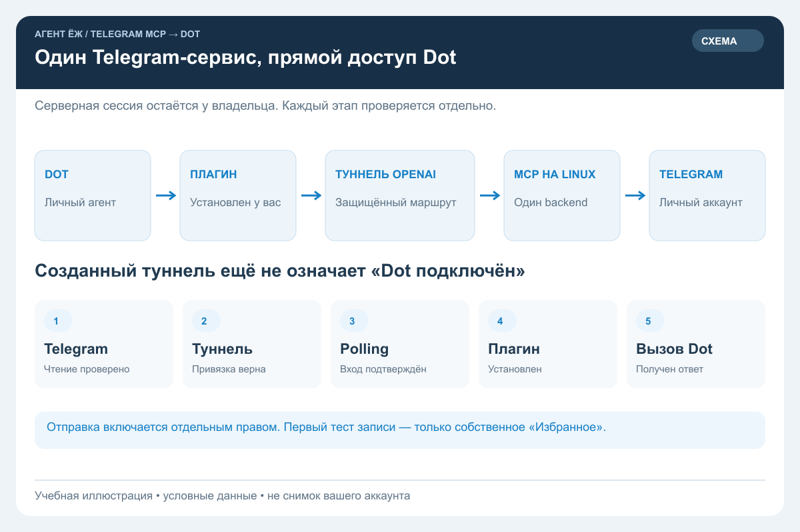
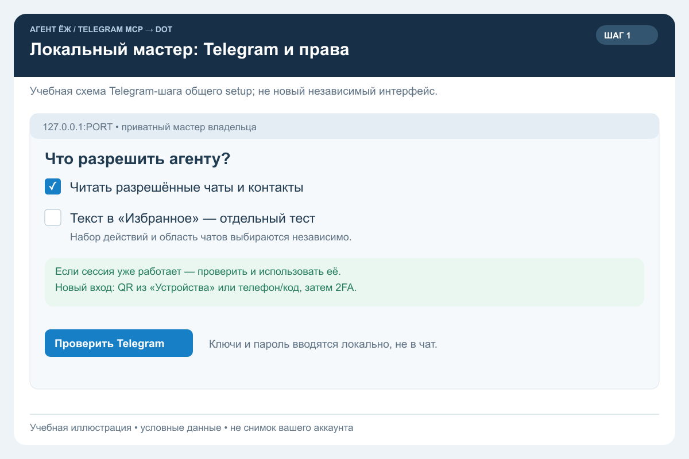
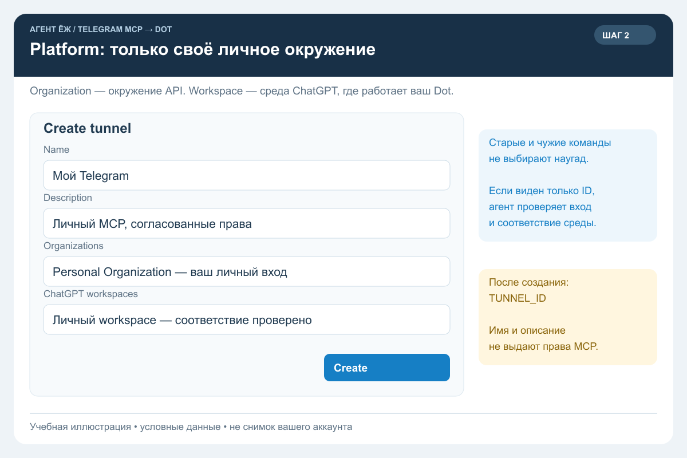
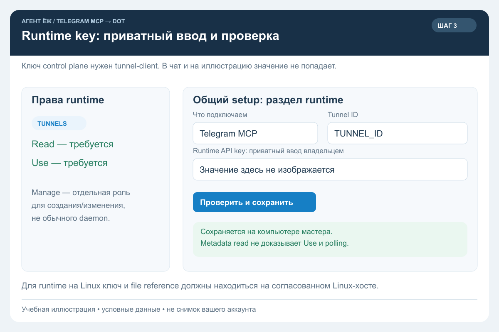
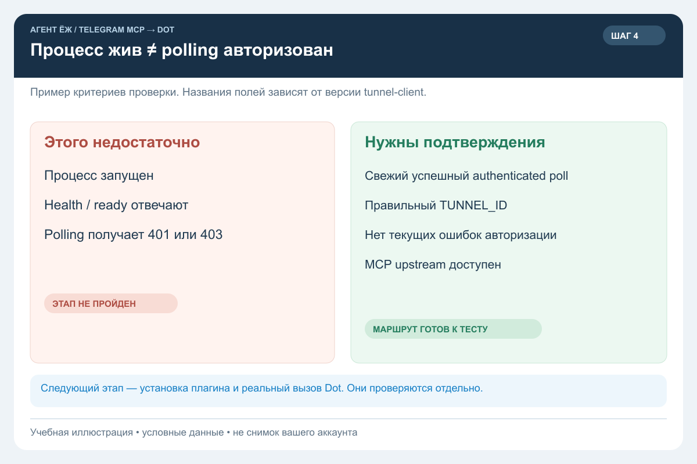
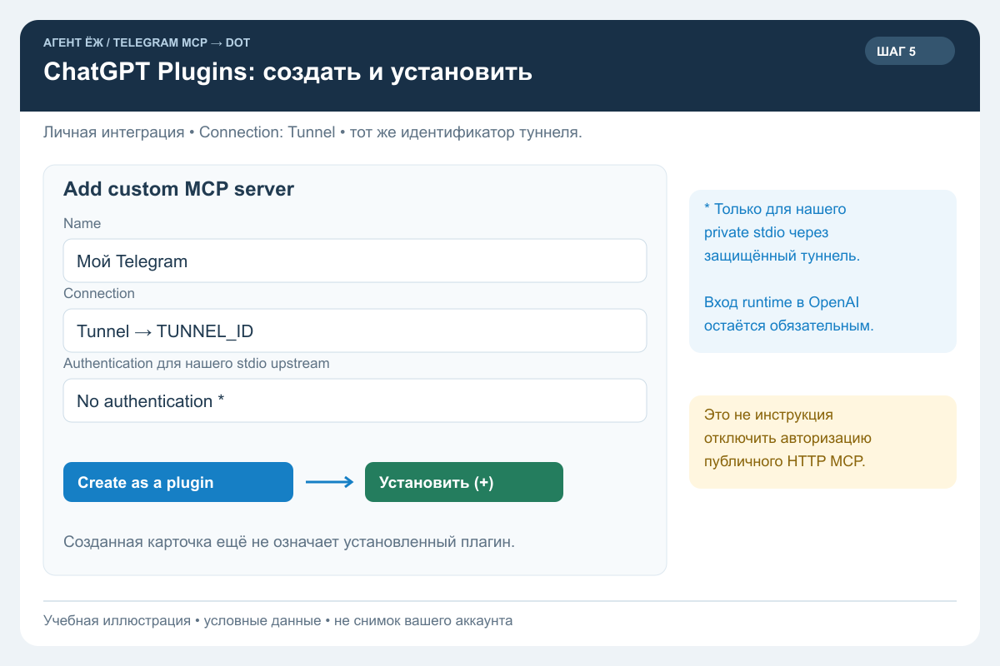
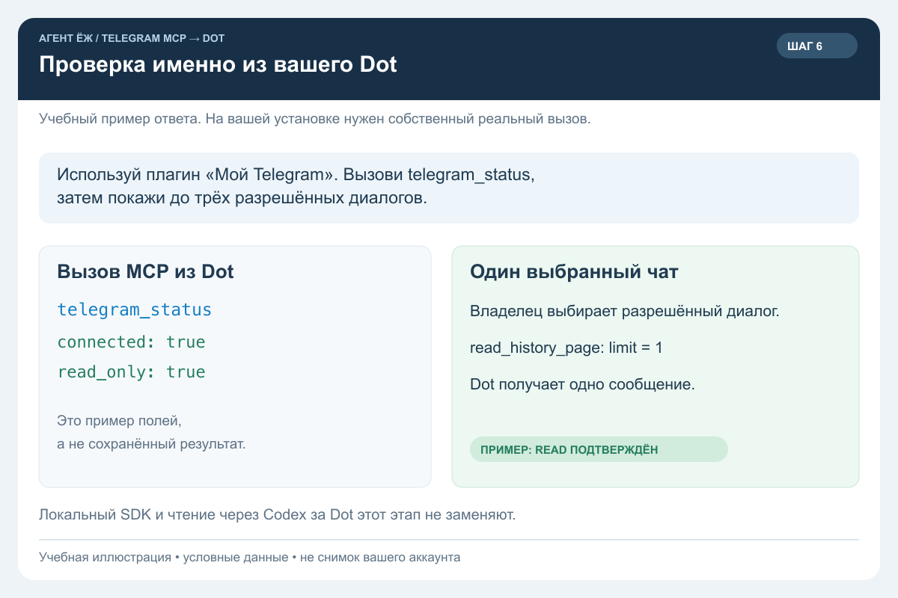
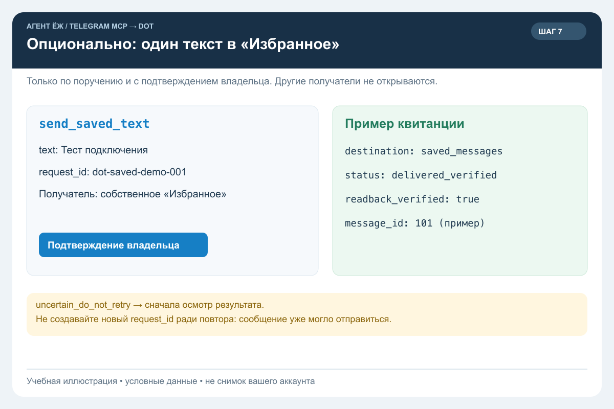

# Личный Telegram в Dot: подключение по шагам

Для владельца ChatGPT и его устанавливающего агента. Путь этой инструкции: **Telegram MCP на вашем Linux → OpenAI Secure MCP Tunnel → личный плагин → ваш Dot**. Не покупайте Business наугад: доступность туннелей, рабочих пространств и нужных прав проверяется в вашем аккаунте. [Официальный путь туннеля](https://developers.openai.com/api/docs/guides/secure-mcp-tunnels).

Все изображения ниже — **учебные иллюстрации с условными данными**, а не снимки личного аккаунта или подтверждение работающего подключения. Названия и расположение элементов интерфейса могут меняться. Полные размеры картинок доступны по нажатию.

## Короткий маршрут

| Шаг | Что делает владелец | Что проверяет агент |
| --- | --- | --- |
| [1. Telegram и права](#step-1) | Выбирает возможности, при необходимости сканирует QR и вводит 2FA локально | Использует существующую сессию либо проверяет новый вход через MCP |
| [2. Личный туннель](#step-2) | Подтверждает личный аккаунт и создание туннеля | Сверяет привязку; сохраняет только идентификатор в приватной настройке |
| [3. Runtime key](#step-3) | Вводит ключ в приватную форму общего мастера | Проверяет полномочия и приватное хранение без вывода значения |
| [4. Работающий маршрут](#step-4) | Смотрит понятный итог проверки | Подтверждает успешный authenticated polling и доступ к MCP |
| [5. Личный плагин](#step-5) | Создаёт и устанавливает плагин в ChatGPT | Проверяет выбранный туннель и доступные инструменты |
| [6. Вызов Dot](#step-6) | Выбирает один разрешённый чат для проверки | Получает настоящий вызов инструмента из самого Dot |
| [7. Отправка, по желанию](#step-7) | Разрешает один тест в собственное «Избранное» | Проверяет квитанцию и чтение отправленного текста обратно |

Установку зависимостей и команды выполняет устанавливающий агент. От владельца не требуется вводить команды в Terminal. Один оператор ведёт Platform и туннель: параллельные агенты не создают дубликаты.

## Какой мастер открывать

Агент ведёт **один маршрут настройки через существующие компоненты**. Telegram-вход реализован в `setup_web.py`; описание — [вход в локальном браузере](web-setup.md). Общий компонент `codex-fleet-mcp/setup-wizard` может быть доступен в отдельной согласованной поставке, но не входит в этот репозиторий. Если его нет, используйте [самостоятельный приватный ввод runtime key](remote-owner-setup.md#2-владелец-выбирает-туннель-и-вводит-runtime-key) через системное окно владельца или скрытый Terminal-ввод. Вторая веб-форма не создаётся; ввод ключа сам по себе не подключает весь сервис.

Владелец открывает локальный мастер на своём компьютере либо через подготовленный агентом защищённый доступ к серверному мастеру. Пароли, API Hash, код Telegram и runtime key вводятся только в приватной форме. Их не отправляют в переписку, issue, публичный конфиг или снимок экрана.

## 1. Проверить Telegram и выбрать права

Агент сначала проверяет уже имеющийся MCP. Рабочую авторизацию сохраняют: повторно входить ради нового клиента не нужно. Для новой установки владелец получает собственные API ID/Hash, вводит их локально, выбирает QR или телефон/код и при необходимости пароль 2FA. QR сканируется из **Telegram → Настройки → Устройства → Подключить устройство**.

Минимальный удалённый профиль — чтение. Отдельно выбирается, какие чаты и контакты видит агент: один тестовый чат или все доступные владельцу. Полный обзор не включает отправку автоматически. Для первой проверки достаточно небольшого разрешённого чата. Если владелец уже выбрал область и возможности, не спрашивайте их повторно.

После входа нужен настоящий MCP status и ограниченное чтение; картинка QR или файл сессии сами по себе этого не доказывают. Сессия остаётся на сервере; код и пароль 2FA не сохраняются и не передаются Dot через инструменты. Подробности — [права](permissions.md) и [Linux-сервис](linux-service.md).

## 2. Создать туннель в своём личном окружении

Откройте [Platform → Tunnels](https://platform.openai.com/settings/organization/tunnels). **Organization** здесь — техническое окружение API; оно может быть личным. **ChatGPT workspace** определяет, в какой среде ChatGPT будет доступен туннель. Это не Telegram-группа и не название проекта.

В форме используйте понятное имя, например «Мой Telegram», описание выбранных возможностей и только ту организацию и среду ChatGPT, принадлежность которых вы подтвердили. Личную среду выбирают, если она действительно доступна для этого туннеля. Слова `read` или `write` в описании не задают права MCP. Случайные старые команды и чужие workspace не выбирают. Если нужная среда показана только идентификатором или отсутствует, агент проверяет соответствие аккаунта и не создаёт Business наугад.

Создание и нужные подтверждения выполняет владелец. Полученный идентификатор здесь обозначен `TUNNEL_ID`; в своей приватной настройке агент использует фактический. Это ещё только созданный маршрут, не работающий клиент. [Привязки и права туннелей](https://developers.openai.com/api/docs/guides/secure-mcp-tunnels).

## 3. Ввести runtime key локально

Для control plane tunnel-client нужен **runtime API key**. В этой схеме браузерный вход в ChatGPT, Telegram QR и OAuth самого MCP не заменяют этот ключ. Владелец создаёт или выбирает подходящий credential; агент проверяет, что его принципалу доступны **Tunnels Read + Use**. Создание/изменение туннелей требует отдельного **Manage**, который не следует выдавать работающему daemon ради обычного использования. [Требования runtime](https://developers.openai.com/api/docs/guides/secure-mcp-tunnels).

Если общий мастер доступен, выберите **Telegram MCP**, свой tunnel ID и вставьте **один** ключ в скрытое поле. Online mode может проверить чтение metadata туннеля; это не проверка `Use`, polling или минимальности всех прав. Если общий мастер отсутствует, используйте [приватный ввод без него](remote-owner-setup.md#2-владелец-выбирает-туннель-и-вводит-runtime-key). Локальное сохранение само по себе не подтверждает полномочия ключа.

Ключ сохраняется **на том компьютере, где работает runtime**. Для Linux требуется локальный ввод либо отдельно согласованный защищённый SSH-поток; file reference с Mac не становится файлом Linux. В командах используются поддерживаемые file/env references; значение не помещают в URL, argv, журнал или картинку. [Контракт](setup-flow-contract.md) и [самостоятельный маршрут](remote-owner-setup.md).

## 4. Подтвердить authenticated polling

Агент подключает установленный tunnel-client к существующему backend по фиксированному stdio-профилю. Удалённый агент получает инструменты и свои права, не копию Telegram-сессии. Не запускайте второго держателя той же сессии.

В доказательстве готовности должны быть успешная диагностика клиента, здоровый/готовый процесс, **успешный авторизованный polling после текущего запуска**, правильный туннель и доступный MCP upstream. PID, `healthy=true` или `ready=true` без подтверждения авторизации недостаточны. При текущих `401/403` шаг не пройден: проверьте credential, его полномочия и привязку. Не обходите ошибку отключением проверки TLS или авторизации.

Названия полей CLI зависят от версии; агент использует её `--help`, диагностические счётчики и редактированный результат проверки. В отчёт не включают заголовки Authorization и ключи. [Устройство и диагностика tunnel-client](https://developers.openai.com/blog/connect-private-mcp-servers-to-openai-products).

## 5. Создать и установить личный плагин

В [ChatGPT Plugins](https://chatgpt.com/plugins) выберите **+ → Add custom MCP server**, имя «Мой Telegram», **Connection: Tunnel** и тот же `TUNNEL_ID`. Создавайте интеграцию в своём личном окружении, затем отдельно установите её кнопкой **+**. Созданная карточка и установленный плагин — разные состояния. [Официальная последовательность](https://developers.openai.com/plugins/quickstart).

В нашем фиксированном stdio-профиле нет собственного OAuth. Если личная привязка и authenticated polling защищённого туннеля проверены, для такого upstream допустим режим **No authentication** в поле *Authentication* плагина. Он относится к upstream, а не отключает авторизацию OpenAI-туннеля. Эту настройку нельзя переносить на публичный HTTP-доступ к личному Telegram. Для другого upstream метод входа выбирается по его реализации. [Методы подключения](https://developers.openai.com/api/docs/guides/custom-mcp-server).

В read-only режиме ожидаются шесть инструментов. Опциональный `send_saved_text` появляется только в соответствующей ревизии и stdio-режиме MVP; наличие инструмента ещё не доказывает выдачу права отправки. Проверьте его flags через status и сохраните подтверждения платформы.

## 6. Проверить вызов из самого Dot

Плагин должен быть установлен и доступен вашему Dot; это зависит от его подключённого аккаунта, прав и среды. [Как Dot использует плагины](https://learn.chatgpt.com/docs/dots/computers-and-apps).

Попросите Dot: «Используй плагин “Мой Telegram”. Вызови `telegram_status`, затем покажи до трёх разрешённых диалогов». Проверьте настоящий вызов MCP, а не обещание агента. Выберите один чат из каталога и попросите прочитать одно сообщение через `read_history_page` с его числовым ID и `limit=1`. Не публикуйте прочитанную переписку в отчёте.

Успех — вызовы выполнены **из Dot**, соединение подтверждено и выбранное сообщение действительно прочитано. Локальный SDK, браузер Telegram и поручение Codex прочитать за Dot этот этап не заменяют.

## 7. По желанию: один текст в собственное «Избранное»

Если владелец хочет проверить запись, агент сначала проверяет наличие [MVP отправки](saved-text-mvp.md) в установленной ревизии. Он требует отдельного разрешения backend `send-text`, права профиля `send-saved-text` и stdio-флага `--enable-saved-text`. Изменение прав/перезапуск готовит оператор; тест не является поводом менять рабочую авторизацию. Файлы и другие получатели этим MVP не открываются.

С подтверждением владельца Dot выполняет **один** `send_saved_text` с текстом «Тест подключения» и уникальным `request_id`. Получатель зафиксирован сервером — собственное «Избранное». Успешная квитанция: `destination=saved_messages`, `status=delivered_verified`, положительный ID сообщения и `readback_verified=true`. Владелец сверяет сообщение в Telegram.

При `uncertain_do_not_retry` сначала проверяют результат. Нельзя менять ID и отправлять снова вслепую. Повтор того же ID и текста возвращает сохранённую квитанцию. Отправку в другие чаты, вложения и остальные действия подключают отдельной задачей.

## Что считать готовым

| Отметка | Достаточное доказательство | Чего она ещё не доказывает |
| --- | --- | --- |
| Telegram подключён | Настоящий MCP read с ожидаемым аккаунтом | Что Dot видит сервер |
| Туннель создан | Объект и привязка подтверждены в Platform | Что runtime авторизован |
| Polling подтверждён | Есть успешный authenticated polling и доступ к MCP | Что плагин установлен |
| Плагин установлен | Он установлен в нужной личной среде и доступен Dot | Что конкретный вызов прошёл |
| Dot прочитал | Реальный MCP-вызов Dot прочитал согласованный чат | Что отправка разрешена |
| Dot отправил, опционально | Один тест доставлен и прочитан обратно | Что разрешены произвольные записи |

**Не получается?** [Агентский handoff](dot-agent-handoff.md) сопоставляет блокер с нужной картинкой. `401/403` относятся к полномочиям runtime; отсутствие туннеля — также к привязке; `send_text_backend_not_enabled` — к выбранным backend-возможностям. При `FloodWait` выдерживают паузу Telegram, а не создают новые сессии.

Инструкция не создаёт защиту от администратора заражённого хоста и не включает автономную переписку. Полноценный Conversation Guard и аппаратная привязка — отдельные этапы. Версию и реальные проверки конкретной установки фиксируют в [верификации](verification.md), а запись [каталога решений](https://github.com/omiusgm/agent-ezh-catalog) используют для поиска решения, не как доказательство живого подключения.
