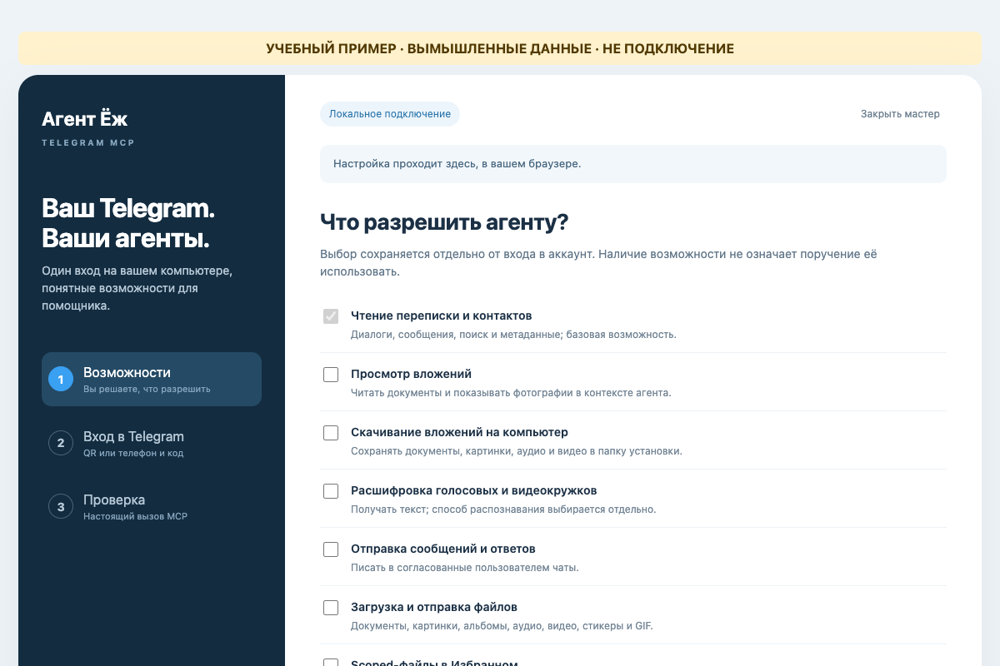
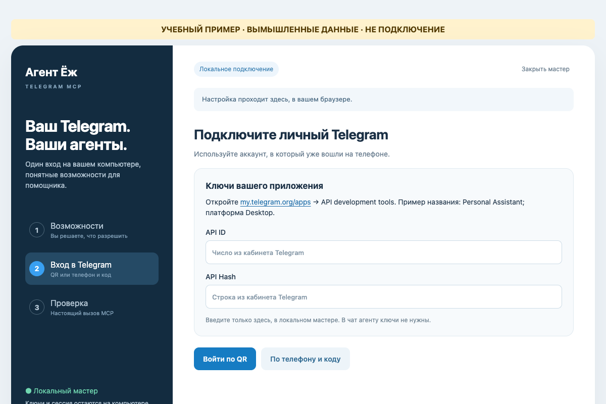
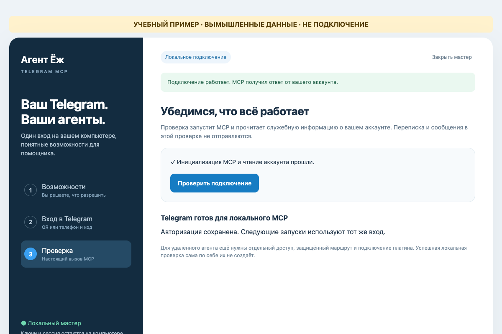

# Подключить свой Telegram: короткий путь

Эта инструкция для владельца и его устанавливающего агента. Она подключает
**личный аккаунт Telegram** к MCP на одном компьютере. Отдельный Telegram-бот
не получает ваши личные диалоги. Если подключение уже работает, сначала
проверьте его: повторный вход и копирование сессии не нужны.

Можно передать своему агенту ссылку на этот репозиторий и короткое поручение:

> Помоги подключить мой личный Telegram по `docs/start-here.md`. Сначала
> проверь существующее подключение и спроси, какие возможности я хочу разрешить.
> Подготовь зависимости и открой локальный мастер. API ID/Hash, код и пароль
> 2FA я введу сам; не проси их в чат. Сохрани другие MCP-настройки. После входа
> проверь подключение и прочитай одно сообщение из выбранного мной чата.

## 1. Подготовка и выбор возможностей

Агент подготавливает отдельную папку проекта, Git, uv и Python 3.11+. На Mac
откройте в этой папке `TelegramSetup.app` через Finder. Это неподписанный
локальный launcher, а не универсальный установщик; если macOS не запускает его,
сообщите агенту текст ошибки. На Linux с рабочим столом агент может создать
ярлык по [инструкции мастера](web-setup.md).

В открывшемся локальном браузере выберите нужные возможности и нажмите
«Подготовить MCP с выбранными правами». Список прокручивается вниз: там есть
вложения, расшифровка, отправка и другие действия. Чтение — базовая возможность;
дополнительные права включаются только по вашему выбору. Для расшифровки
отдельно выбирается способ и, если нужен внешний сервис, передача ему аудио.
Мастер скачивает закреплённые зависимости; Git и uv он сам не устанавливает.

## 2. Вход владельца

Если у вас нет API ID и API Hash, войдите на [my.telegram.org/apps](https://my.telegram.org/apps)
и откройте **API development tools**. Для нового приложения можно указать
название `Personal Assistant`, короткое имя `personalassistant` и платформу
Desktop. Создание приложения и принятие условий выполняете вы.

Введите API ID и API Hash **в поля локального мастера**, затем выберите QR или
телефон и код. Для QR на телефоне откройте Telegram → **Настройки → Устройства
→ Подключить устройство**. Если появится запрос двухэтапной защиты, введите
пароль Telegram там же, в мастере. Это не код из SMS и не пароль компьютера.
Не присылайте агенту API Hash, QR, код, пароль или файл сессии.

Если Telegram пишет `Too many attempts`, прекратите повторы и дождитесь снятия
ограничения. При неверном QR используйте свежий код и сканер в разделе
«Устройства». Подробнее: [диагностика](troubleshooting.md).

## 3. Проверка и подключение агента

Нажмите в мастере «Проверить подключение». Проверка выполняет MCP handshake и
читает служебную информацию аккаунта; она не отправляет сообщений. Зелёный
результат на картинке ниже — **только пример**, не проверка вашего аккаунта.
После вашего входа агент регистрирует эту установку в нужном локальном клиенте
и проверяет доступные инструменты и одно сообщение из выбранного вами чата.
Новая сессия клиента может понадобиться для загрузки настроек MCP.

Если мастер не открыл браузер, откройте его снова; агенту достаточно проверить
Python и браузер. При работающем MCP не начинайте новый вход из-за одной ошибки:
сначала проверьте текущий статус. Файлы авторизации не удаляются автоматически.

## Если агент работает в облаке или на другом компьютере

Локальный вход сам по себе не подключает удалённого агента. Нужны отдельные
права, защищённый маршрут и реальный вызов именно этого клиента. Начните с
[пошагового маршрута удалённого подключения](remote-owner-setup.md); для Dot
есть [иллюстрированная инструкция](dot-client-guide.md). Отдельный аккаунт
или новая копия Telegram-сессии для каждого агента не нужны.

## Что включается отдельно

- **Файлы и фото.** Локальное скачивание и удалённые MCP-вложения — разные
  права. У удалённого gateway действует лимит 5 МиБ; получение настоящих байтов
  и SHA-256 проверяют у конкретного клиента. [Вложения](attachments.md).
- **Опросы.** Чтение, создание и закрытие своих опросов требуют отдельных прав;
  для записи также нужна разрешённая цель. Наличие инструмента не означает,
  что публикация поручена. [Опросы](polls.md).
- **BotFather.** Создание и обслуживание своих ботов экспериментальны и
  выключены по умолчанию. Историю BotFather не открывают для диагностики — в
  ней могут быть токены. [Боты](owned-bots.md), [границы защиты](botfather-output-guard.md).

Все три изображения выше получены из настоящей страницы мастера с искусственным
состоянием. В них нет действующих QR, ключей, сообщений или данных аккаунта.
