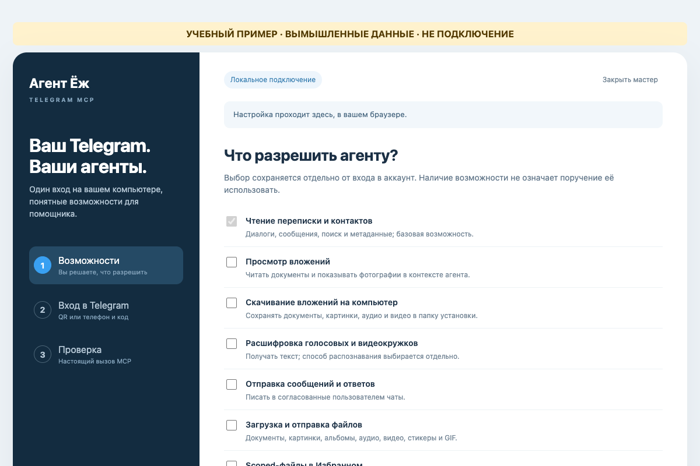
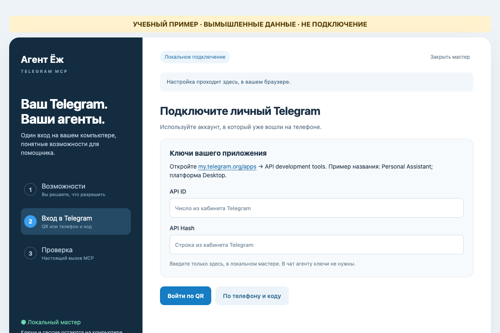
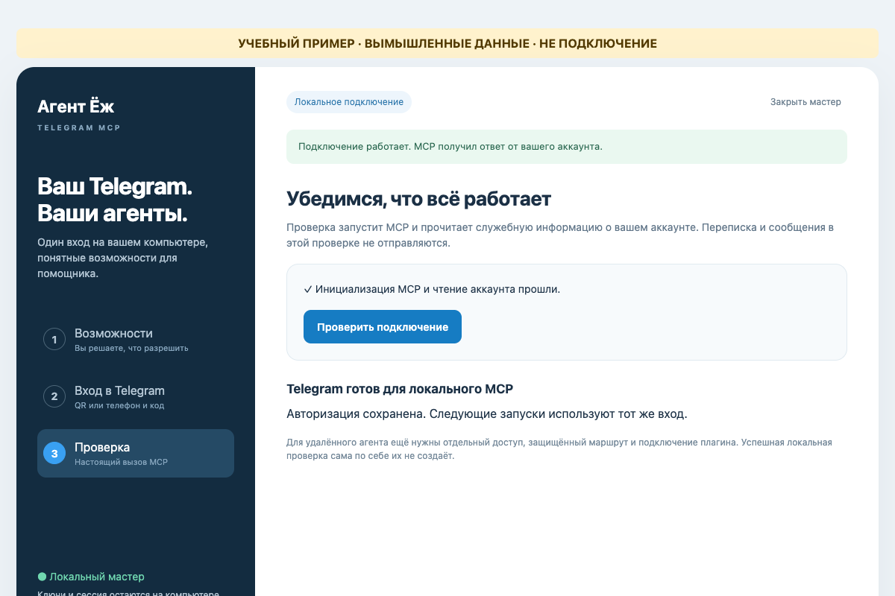

# Подключить свой Telegram: короткий путь

Эта инструкция для владельца и его устанавливающего агента. Она подключает
**личный аккаунт Telegram** к MCP на одном компьютере. Отдельный Telegram-бот
не получает ваши личные диалоги. Если подключение уже работает, сначала
проверьте его: повторный вход и копирование сессии не нужны.

Можно передать своему агенту ссылку на этот репозиторий и короткое поручение:

> Помоги подключить мой личный Telegram по `docs/start-here.md`. Сначала
> проверь существующее подключение и спроси, какие возможности я хочу разрешить.
> Объясни варианты получения пары приложения и условия обработки переписки ИИ.
> Подготовь зависимости и открой локальный мастер. API ID/Hash, код и пароль
> 2FA я введу сам; не проси их в чат. Сохрани другие MCP-настройки. После входа
> проверь подключение и прочитай одно сообщение из выбранного мной чата.

<a id="client-file-prompt"></a>
### Если у вас уже есть файл от Владимира или друга

Даже если Telegram раньше показывал `Too many attempts` при регистрации приложения, с полученным файлом эту форму можно пропустить. Сохраните файл на своём компьютере вне папки проекта. В чат с агентом скопируйте **только поручение**:

```text
Подключи мой личный Telegram по обновлённой инструкции https://github.com/omiusgm/agent-telegram-setup/blob/main/docs/start-here.md. У меня есть telegram-app.tgapp от владельца приложения, поэтому мне не нужно создавать приложение на my.telegram.org.

Сначала проверь существующее подключение. Если оно работает, сохрани текущий вход. Если вход не завершён, проверь установку и обнови её из main с сохранением моих настроек и локальных данных. Объясни, какие выбранные чаты и данные увидит агент и облачная модель. Уточни права, если я их ещё не выбрал.

Открой локальный мастер на шаге «Вход в Telegram». Попроси меня нажать «Выбрать файл приложения» и указать .tgapp. Файл выбираю я сам; не проси прикрепить его к чату и не открывай его содержимое. Я нажму «Войти по QR», отсканирую код своим Telegram и при необходимости сам введу 2FA.

После входа проверь чтение одного выбранного мной тестового сообщения в «Избранном» и сообщи результат.
```

<a id="without-own-app"></a>
### Как подключиться без регистрации своего API-приложения

| Когда подойдёт | Что выбрать | Где хранится сессия |
|---|---|---|
| Владимир или друг прислал файл для этого MCP | Используйте `.tgapp` по поручению выше. Если вы личный клиент Владимира, запросить файл можно у [@omius](https://t.me/omius). | На компьютере, где вы запустили наш мастер. |
| У вас Mac с Apple Silicon, macOS 12+ и локальный агент | **FinchGram**. Готовая сборка содержит ключи приложения проекта. Войдите по QR, откройте **Toolbox → AI → AI access**, выберите один тестовый чат и режим без отправки. Подключите локальный MCP по инструкции проекта. [Релиз 0.8.2](https://github.com/FinchGram/FinchGram/releases/tag/v0.8.2) · [Инструкция MCP](https://github.com/FinchGram/FinchGram/blob/v0.8.2/docs/mcp.md) | На вашем Mac в стороннем Telegram-клиенте. Выбор чатов ограничивает ассистента. Полученный текст может обрабатываться облачной моделью. |
| Вам нужен удалённый MCP и вы доверяете оператору хранение сессии | **MCTL в размещённом сервисе**. Пользователь проходит вход в браузере и выбирает права, например чтение. Поддержка зависит от MCP-клиента. При самостоятельном развёртывании пару API регистрирует оператор. [Репозиторий](https://github.com/mctlhq/mctl-telegram) · [Подключение и поддерживаемые клиенты](https://tg.mctl.ai/docs) | Оператор сервиса хранит зашифрованную сессию и обрабатывает запросы к Telegram. |

Для первого теста FinchGram в локальном Codex можно ограничить команды через `enabled_tools = ["search_chats", "search_messages", "get_messages"]` в его секции MCP. У FinchGram 0.8.2 есть отдельная команда `mark_read`; обычный поиск и чтение её не вызывают. Сквозной вход в сторонние решения на вашем аккаунте требует проверки. [Настройки MCP Codex](https://developers.openai.com/codex/mcp)

## 1. Подготовка и выбор возможностей

Агент подготавливает отдельную папку проекта, Git, uv и Python 3.11+. На Mac
откройте в этой папке `TelegramSetup.app` через Finder. Это неподписанный
локальный launcher, а не универсальный установщик; если macOS не запускает его,
сообщите агенту текст ошибки. На Linux с рабочим столом агент может создать
ярлык по [инструкции мастера](web-setup.md).

В открывшемся локальном браузере выберите нужные возможности и нажмите
«Подготовить MCP с выбранными правами». Список прокручивается вниз: там есть
вложения, расшифровка, отправка и другие действия. Чтение — базовая возможность;
дополнительные права включаются только по вашему выбору. Для расшифровки
отдельно выбирается способ и, если нужен внешний сервис, передача ему аудио.
Мастер скачивает закреплённые зависимости; Git и uv он сам не устанавливает.



## 2. Вход владельца

<a id="app-credentials"></a>
### Выберите приложение для входа

- **Своё приложение.** Используйте имеющуюся пару `api_id` и `api_hash` или получите её в [API development tools](https://my.telegram.org/apps).
- **Приложение Владимира для личных клиентов.** Если регистрация не удаётся или вы договорились использовать его приложение, напишите Владимиру Кривошееву в личку [@omius](https://t.me/omius). Он может прислать файл приложения или две строки. Если у вас только Hash, запросите соответствующий ID.
- **Файл от друга.** Если друг разрешил использовать его приложение, попросите прислать файл `.tgapp` лично. На шаге **Вход в Telegram** нажмите **«Выбрать файл приложения»** и укажите файл. Мастер также принимает небольшой `.env` в формате ниже. Агент открывает мастер. Файл выбираете вы сами.

#### Как поделиться своим приложением

Попросите агента: **«Открой на моём компьютере `scripts/create-client-file.html` из этого репозитория. API ID и Hash я введу сам»**. Эта [локальная форма](../scripts/create-client-file.html) работает без сети. Введите оба значения из раздела **API development tools** на [my.telegram.org/apps](https://my.telegram.org/apps) и нажмите **«Сохранить telegram-app.tgapp»**. Передайте файл лично получателю. Он сможет прочитать и скопировать ключи. Храните заполненный файл вне проекта.

Формат файла — обычный текст UTF-8, до 1 КиБ, две строки в указанном порядке. Без кавычек и дополнительных параметров. Для ручного ввода можно вставить эти строки вместе в поле **API ID**.

```text
API_ID=<число приложения>
API_HASH=<32 шестнадцатеричных символа>
```

Пара определяет приложение. Вы входите в свой аккаунт, выбираете права агента и можете завершить свою сессию в Telegram → Настройки → Устройства. При установке на вашем компьютере сессия хранится у вас, а соединение с Telegram идёт напрямую. Сама пара не даёт Владимиру доступ к вашей переписке. Получатель может скопировать оба значения. У общей пары нет отдельного отзыва для одного клиента; ограничение приложения со стороны Telegram может затронуть всех его пользователей. Используйте пару только для согласованного подключения. Не публикуйте значения в GitHub и не передавайте их агенту, в логи или на скриншоты.

**До чтения переписки** узнайте, какие чаты увидит агент и кто обрабатывает данные. Облачная модель может получить сообщения, которые агент использует для задачи. Telegram ограничивает использование данных платформы для ИИ. Условия допускают возможность исключений при индивидуальном, явном, информированном и продолжающемся согласии всех затронутых пользователей для конкретного содержания и чата. QR подтверждает только ваш вход. Для первой проверки подойдёт ваше тестовое сообщение в «Избранном». [Условия API Telegram](https://core.telegram.org/api/terms) · [Правила использования контента](https://telegram.org/tos/content-licensing).

Когда оба поля заполнены, выберите QR или
телефон и код. Для QR на телефоне откройте Telegram → **Настройки → Устройства
→ Подключить устройство**. Если появится запрос двухэтапной защиты, введите
пароль Telegram там же, в мастере. Это не код из SMS и не пароль компьютера.
Не присылайте агенту API Hash, QR, код, пароль или файл сессии.



Если Telegram пишет `Too many attempts`, прекратите повторы и дождитесь снятия
ограничения. При неверном QR используйте свежий код и сканер в разделе
«Устройства». Подробнее: [диагностика](troubleshooting.md).

## 3. Проверка и подключение агента

Нажмите в мастере «Проверить подключение». Проверка выполняет MCP handshake и
читает служебную информацию аккаунта; она не отправляет сообщений. Зелёный
результат на картинке ниже — **только пример**, не проверка вашего аккаунта.
После вашего входа агент регистрирует эту установку в нужном локальном клиенте
и проверяет доступные инструменты и одно сообщение из выбранного вами чата.
Новая сессия клиента может понадобиться для загрузки настроек MCP.



Если мастер не открыл браузер, откройте его снова; агенту достаточно проверить
Python и браузер. При работающем MCP не начинайте новый вход из-за одной ошибки:
сначала проверьте текущий статус. Файлы авторизации не удаляются автоматически.

## Если агент работает в облаке или на другом компьютере

Локальный вход сам по себе не подключает удалённого агента. Нужны отдельные
права, защищённый маршрут и реальный вызов именно этого клиента. Начните с
[пошагового маршрута удалённого подключения](remote-owner-setup.md); для Dot
есть [иллюстрированная инструкция](dot-client-guide.md). Отдельный аккаунт
или новая копия Telegram-сессии для каждого агента не нужны.

## Что включается отдельно

- **Файлы и фото.** Локальное скачивание и удалённые MCP-вложения — разные
  права. У удалённого gateway действует лимит 5 МиБ; получение настоящих байтов
  и SHA-256 проверяют у конкретного клиента. [Вложения](attachments.md).
- **Опросы.** Чтение, создание и закрытие своих опросов требуют отдельных прав;
  для записи также нужна разрешённая цель. Наличие инструмента не означает,
  что публикация поручена. [Опросы](polls.md).
- **BotFather.** Создание и обслуживание своих ботов экспериментальны и
  выключены по умолчанию. Историю BotFather не открывают для диагностики — в
  ней могут быть токены. [Боты](owned-bots.md), [границы защиты](botfather-output-guard.md).

Все три изображения выше получены из настоящей страницы мастера с искусственным
состоянием. В них нет действующих QR, ключей, сообщений или данных аккаунта.
